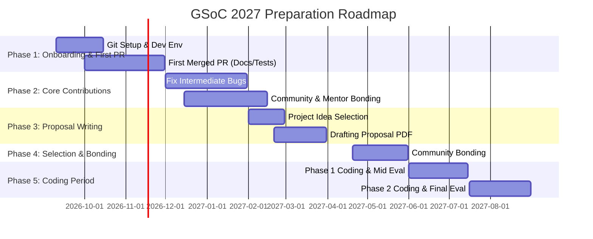

# GSoC 2027 NumFOCUS Roadmap (Python & Data Science / AI)

> **Timeline Target**: Google Summer of Code 2027  
> **Current Date**: September 2026 *(Phase: Early Preparation & Contribution)*  
> **Primary Domain**: Python, Data Science, AI/ML (NumFOCUS Umbrella)

---

## 🎯 Top NumFOCUS Python Projects Overview

NumFOCUS sponsors many leading open-source Python projects. Select **1 primary project** (and 1 backup) based on your technical interests:

| Project | Core Stack | Best For | Good First Issue Tags |
| :--- | :--- | :--- | :--- |
| **SymPy** | Pure Python, Computer Algebra | Symbolic math, calculus, logic | `EasyToFix`, `good first issue` |
| **Scikit-learn** | Python, Cython, C++ | Machine Learning, algorithms | `Good First Issue`, `easy` |
| **Pandas** | Python, Cython, C | Data structures, data analysis | `good first issue`, `Needs Tests` |
| **NumPy** | Python, C, C-API | Array computing, N-dimensional arrays | `good first issue`, `component: docs` |
| **Jupyter / JupyterLab** | Python, TypeScript, React | Interactive computing tools | `good first issue`, `help wanted` |
| **PyMC** | Python, PyTensor | Probabilistic programming, Bayesian stats | `good first issue`, `beginner-friendly` |
| **NetworkX** | Pure Python | Graph theory, network analysis | `good first issue`, `type hints` |
| **Dask** | Python | Parallel & distributed computing | `good first issue` |

---

## 📅 Timeline Strategy (September 2026 – August 2027)



---

## 🚀 Step-by-Step Execution Plan

### Step 1: Pick Your Target Project & Join Communication Channels
1. **Choose 1 primary project**: For beginners in pure Python, **SymPy** or **NetworkX** are great starting points because they have pure-Python modules without heavy compilation steps. For ML/Data Science enthusiasts, **Scikit-learn** or **Pandas** are top choices.
2. **Join the Community Channels**:
   - **SymPy**: Gitter/Matrix (`sympy/sympy`), Mailing list (`sympy@googlegroups.com`).
   - **Scikit-learn**: Gitter/Matrix, Discussion forums.
   - **Pandas**: Developer Mailing list, GitHub Discussions.
   - **NumPy**: Discourse (`numpy.discourse.group`), Slack/Matrix.

---

### Step 2: Set Up Local Development Environment
For Python projects, create an isolated environment with editable package installs (`pip install -e .`):

```bash
# 1. Fork the repo on GitHub
# 2. Clone your fork locally
git clone https://github.com/<your-username>/<project-name>.git
cd <project-name>

# 3. Create a virtual environment or conda env
python -m venv venv
# On Windows:
.\venv\Scripts\activate

# 4. Install dev dependencies and editable package
pip install -r requirements-dev.txt
pip install -e .

# 5. Run test suite to confirm setup
pytest
```

---

### Step 3: Land Your First Merged Pull Request (Sept – Nov 2026)
To maximize your application score (`5 pts` for PR on existing code + `5 pts` for mentor communication):

1. **Find beginner-friendly issues**:
   - Look for labels: `good first issue`, `easy`, `documentation`, `type-hints`, `needs-test`.
2. **Workflow for your first PR**:
   ```bash
   git checkout main
   git pull upstream main
   git checkout -b fix/issue-description
   
   # Write code + tests
   pytest path/to/test_file.py
   
   # Code quality checks
   ruff check .
   git add .
   git commit -m "fix(module): clear description of fix (closes #1234)"
   git push origin fix/issue-description
   ```
3. **Engage constructively on PR reviews**: Respond politely to review comments and update your PR promptly.

---

### Step 4: Become a Key Contributor (Dec 2026 – Jan 2027)
- Tackle **medium-difficulty bugs** or performance enhancements.
- Help review PRs from other newcomers.
- Answer questions on GitHub Discussions / Matrix channels.
- Build a track record of **5–10 merged PRs** before the GSoC organization announcements in February!

---

### Step 5: Draft a Winning GSoC Proposal (Feb – Mar 2027)
Follow the checklist in [NUMFOCUS_GSOC_GUIDE.md](./NUMFOCUS_GSOC_GUIDE.md):

1. **Select an Idea**: Pick a project from the official GSoC 2027 Idea List (or propose a mentor-backed custom feature).
2. **Structure Your Proposal**:
   - **Title**: `[SubOrgName] Proposal Title`
   - **Abstract**: Concise summary of what will be implemented.
   - **Technical Architecture**: Class designs, function signatures, dependencies, algorithm pseudocode.
   - **Milestones & Deliverables**: Break down into 2-week sub-projects.
   - **Contingency & Buffer Time**: Account for university exams and code review delays.
   - **Proof of Capability**: Links to your merged PRs and portfolio.
3. **Submit Early for Review**: Share a draft PDF with mentors weeks before the deadline.

---

## 🏆 Scoring Checklist Reminder

Make sure your application achieves maximum points:

- [ ] `5 pts` Mentor communication established early
- [ ] `5 pts` Community interaction on public channels
- [ ] `5 pts` Links to prior code / repos / PRs
- [ ] `5 pts` Multiple contact methods (GitHub, Email, Matrix/Discord)
- [ ] `3 pts` Detailed timeline plan (Before, During, After GSoC)
- [ ] `3 pts` Motivation & project selection justification
- [ ] `3 pts` Explicit time commitment statement
- [ ] `1 pt` Public cloud link (PDF application)
- [ ] `5 pts` At least 1 merged PR on codebase before selection
- [ ] `5 pts` Continued communication until accepted contributors announced
